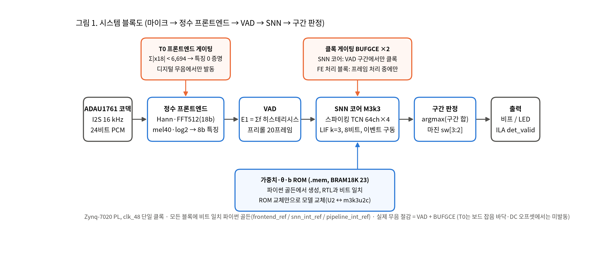

# snn-kws-fpga — 저전력 키워드 인식(KWS)을 위한 스파이킹 신경망의 FPGA 직접 구현

마이크 → 정수 프론트엔드(log-mel) → 스파이킹 신경망(SNN) → 구간 판정까지 **전부 직접 작성한 정수 RTL**로 Zynq-7020(ZSK 보드, ADAU1761 코덱) PL에 올린 키워드 인식기입니다.
파이썬 정수 골든 모델이 기준이고, RTL은 골든과 **비트 단위로 일치**합니다(시뮬레이션 회귀 + 보드 골든 주입 확인).

- 데이터셋: Google Speech Commands v2, 12클래스(yes/no/stop/go/up/down/left/right/on/off + silence + unknown)
- 모델: M3k3 — 인과 확장 합성곱(K=3, dilation 1/2/4/8) + LIF 뉴런 64 × 4층 + FC 64→12, 8비트 QAT + 지식 증류, 파라미터 45,312
- 프론트엔드: 16 kHz, 30 ms 창 / 10 ms 홉, Hann·FFT512(18비트)·mel40·log2(Q6.4), 8비트 특징
- 판정: 프레임 에너지 히스테리시스 VAD가 연 구간에서만 SNN이 돌고 구간 합 argmax, 동작점 스위치(마진 0/2838/6212/9633)
- 저전력: VAD 이벤트 구동 + BUFGCE 클록 게이팅 2개(SNN 코어, 프론트엔드 처리 블록), 단일 48 MHz 클록

시연 영상: _(링크 자리)_

## 1. 시스템 구조



코덱의 24비트 PCM → 정수 프론트엔드(8비트 특징 40개/프레임) → VAD(E1 = Σ특징, 프리롤 20프레임) → SNN 코어(이벤트 구동, 0 입력 건너뛰기) → 구간 판정 → LED/비프. 가중치 ROM(`.mem`)은 골든에서 생성됩니다. 자세한 그림 13장과 캡션은 [`snn/docs/figures/final/index.md`](snn/docs/figures/final/index.md).

## 2. 폴더 구조

```
snn/
  frontend/   정수 프론트엔드 골든(frontend_ref.py, fe_config.py), ROM 생성(export_roms.py), 검증
  golden/     SNN 정수 골든(snn_int_ref.py), 전체 파이프라인 골든(pipeline_int_ref.py), .mem/벡터 생성
              vectors/  RTL 회귀용 골든 벡터(최종 ROM m3k3 클립 12개·스트리밍, 파이프라인·활동량 스트림)
  models/     학습용 PyTorch 모델(LIF, QLinear, M3k3), baseline/ DS-CNN 비교 모델
  data/       데이터셋 → 정수 특징 npz(make_dataset.py), 분할 목록(filelist_*.json)
  train_snn.py, run_*.sh   학습(float → 8비트 QAT+KD), 주차별 실행 스크립트
  eval/       스트림·VAD 평가(vad_eval.py), 검출 곡선, 혼동행렬, 레벨 스윕, 재생 시험 채점(playback_score.py,
              playback_compare.py), 전력 로그 분석(power_log_analyze.py), 레일 전류(power_rails.py)
  rtl/        직접 작성한 Verilog: kws_top.v(통합), fe/(프론트엔드), snn_core.v·lif_update.v·row_acc.v…,
              vad.v, preroll_buf.v, decision_seg.v, clk_gate_buf.v(BUFGCE 게이팅); OOC 합성 tcl·xdc, Yosys 스크립트
  tb/         Icarus/Verilator 테스트벤치와 회귀 스크립트(클립·스트리밍·프론트엔드·파이프라인·활동량)
  rom/        최종 ROM(U2, 접두사 m3k3) .mem 14개 + 프론트엔드 ROM(Hann, twiddle, mel40, log2), 포맷 설명 README
  board/pkg/  보드 패키지: user_logic.v(레퍼런스 디자인의 user_logic 교체본), ila_kws.xdc, build_bitstream.tcl,
              vitis_xsct.tcl, 코덱 초기화 C(reg_set_init_16k_v0/vA/vB/vC.c), 전력 흐름 tcl, 보드 절차서(BOARD_STEP1/2.md)
  board/play/ 재생 시험 생성(make_playback_test.py), 정답표, 디지털 골든 결과, 보정 톤 wav
  board/results/  보드 재생 시험 채점 결과(R0/R2/R0b), 슬롯별 비교, 전력 마크 양식
  docs/       보고서 그림 생성 스크립트, figures/final/ 300 dpi PNG 13장 + 캡션
  results/    런 요약표(summary.md), Vivado 구현·전력(vivado_impl.md), 모델 비교, 혼동행렬 json
```

**의존성(저장소에 포함하지 않음)**: Speech Commands v2 데이터셋, 학습 체크포인트(.pt), Vivado/Vitis 산출물, 그리고 **리버트론 ZSK 오디오 레퍼런스 디자인**(`ZSK_Design_Top.v`, `adau1761_interface.v`, I2S, 제약, 코덱 초기화 C). 보드 빌드는 그 레퍼런스 디자인 위에 `user_logic`만 `board/pkg/user_logic.v`로 교체하고, 톱 레벨은 `board/pkg/ZSK_Design_Top.v.diff`만큼 수정합니다.

## 3. 재현 순서

환경: Python 3.11, PyTorch(CUDA), numpy, soundfile, librosa; Icarus Verilog 13 / Verilator 5(시뮬); Vivado·Vitis 2023.2(보드). 모든 명령은 저장소 루트에서 실행합니다(스크립트가 `snn/...` 경로를 가정).

1. **정수 골든·ROM**
   ```
   python snn/frontend/export_roms.py            # 프론트엔드 ROM(.mem)
   python snn/frontend/verify_frontend.py --n 100 # float 기준 대비 정수 프론트엔드 검증
   ```
2. **데이터셋 → 특징** (Speech Commands v2 경로는 `snn/data/make_dataset.py` 인자)
   ```
   python snn/data/make_dataset.py --classes 12 --n_mels 40 --win 480 --aug_copies 2
   ```
3. **학습** (float 60 에폭 → 8비트 QAT + KD; U2 = unknown 3배 + 손실 가중)
   ```
   python snn/train_snn.py --model M3 --k 3 --epochs 60 ...        # run_week1.sh / run_week4_A.sh 참고
   bash snn/run_qat.sh <float_run>
   python snn/golden/export_snn_mem.py --run snn/runs/<run> --prefix m3k3   # .mem + params.json
   python snn/golden/dump_vectors.py   --run snn/runs/<run> --prefix m3k3   # RTL 골든 벡터
   ```
   저장소의 `snn/rom/m3k3_*.mem`은 보드에 올린 최종 ROM(U2 s0)이며, 위 단계를 건너뛰어도 4·5는 그대로 됩니다.
4. **RTL 시뮬레이션** (골든 비트 일치 회귀)
   ```
   cd snn/tb && ./run_all_vecs.sh m3k3 1          # 클립 12개, zero-skip on
   cd snn/tb/pipeline && ./run_pipeline.sh ../../golden/vectors/pipeline_v3/stream_0 48   # 프론트엔드+VAD+SNN+판정
   cd snn/tb/fe && ./run_fe_blocks.sh             # 프론트엔드 블록별
   cd snn/tb/activity && ./run_activity.sh        # 활동량·클록 CE 듀티
   ```
5. **Vivado 빌드·보드** (Windows, `BOARD_STEP1.md` 절차)
   ```
   vivado -mode batch -source snn/board/pkg/build_bitstream.tcl -tclargs <repo>/snn
   xsct snn/board/pkg/vitis_xsct.tcl <repo>/snn/board/pkg <ws> 16k_vC run      # 코덱 vC(+26 dB) 앱
   ```
   스위치: SW1·SW0 모드(패스스루/골든 주입/라이브/캡처), SW3·SW2 마진, SW5 게이팅 끔, SW6 비프 음소거. 재생 시험·전력 로깅은 `BOARD_STEP2.md`, 채점은 `snn/eval/playback_score.py`.

## 4. 핵심 결과

**정확도** (Speech Commands v2 test, 클립 기준)

| 모델 | 12클래스 | 10클래스 | 비고 |
|---|---|---|---|
| DS-CNN 24ch (float, 같은 정수 특징 입력) | 89.08 ± 0.17 % | 91.66 % | 시드 3개 |
| SNN M3k3 8비트 QAT+KD (base) | 87.67 ± 0.43 % | 89.59 % | 시드 3개, 정수 골든 추론 |
| SNN M3k3 U2 (최종 ROM, unknown 강화) | 85.41 % (s0) | – | unknown 재현율 92.6 % (DS-CNN 66.1 %) |

**구현 자원·전력** (Vivado 2023.2, xc7z020clg484-1, 48 MHz, 구현 결과끼리)

| | hls4ml DS-CNN KWS 계층(1단계) | 본 설계 kws_top (FE+VAD+SNN+판정) | 비 |
|---|---|---|---|
| LUT / FF | 19,710 / 34,917 | 5,173 / 5,795 | 3.8× / 6.0× |
| BRAM18K / DSP | 111 / 63 | 39 / 9 | 2.8× / 7× |
| PL 동적 전력, vectorless (추정) | ≈ 0.116 W | 0.029 W | ≈ 4× |
| PL 동적 전력, SAIF 활동량 (추정) | – | 0.019~0.024 W (게이팅 off) → **≈ 0.006 W** (게이팅 on, 듀티 가중) | 3.7~4× |

전력은 모두 Vivado 모델 추정값이며 보드 실측(N6705C, `snn/eval/power_log_analyze.py`)은 향후 과제입니다. 클록 게이팅 CE 동작은 보드 ILA로 확인했습니다(`fig12`).

**보드 재생 시험** (test 클립 210슬롯 wav를 PC 스피커로 재생, 코덱 vC, 8 cm, 체인 이득 +1 dB; `snn/board/results/`)

| | 마진 0 | 마진 6212 |
|---|---|---|
| 디지털 골든(같은 wav) 키워드 정검출 | 83.8 % (FA 3/50) | 56.9 % (FA 0/50) |
| 보드 R0 / R0b | 70.0 % / 72.5 % (FA 9/50 / 6/50) | R2: 41.2 % (FA 1/50) |
| R0–R0b 슬롯 재현율 | 93.8 % | |

보드 손실은 대부분 낮은 레벨 클립의 무검출이며 음향 경로·잡음 바닥이 원인으로 추정됩니다(골든은 ±3 dB 레벨 변화에 둔감). 사람 발화 간이 시험 16/20.

## 5. 라이선스·출처
- Speech Commands v2: Google, CC BY 4.0. `snn/golden/vectors/`의 회귀 벡터는 이 데이터셋 클립에서 만든 정수 특징·PCM입니다.
- ZSK 보드 레퍼런스 디자인(리버트론)은 포함하지 않으며, 보드 빌드 시 별도로 필요합니다.
- 이 저장소의 코드·RTL·문서: 경진대회 제출용 공개본.
